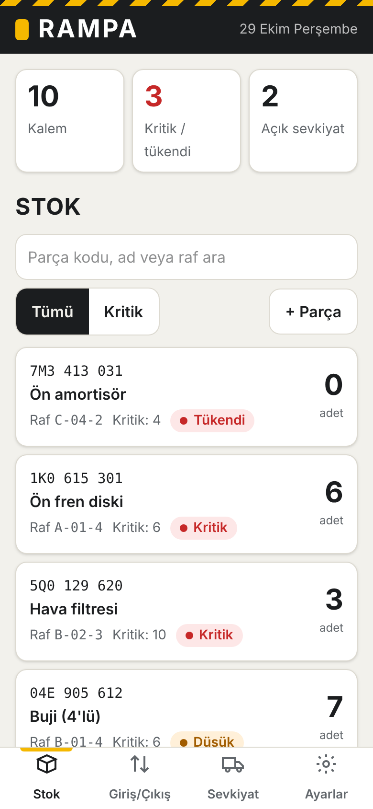
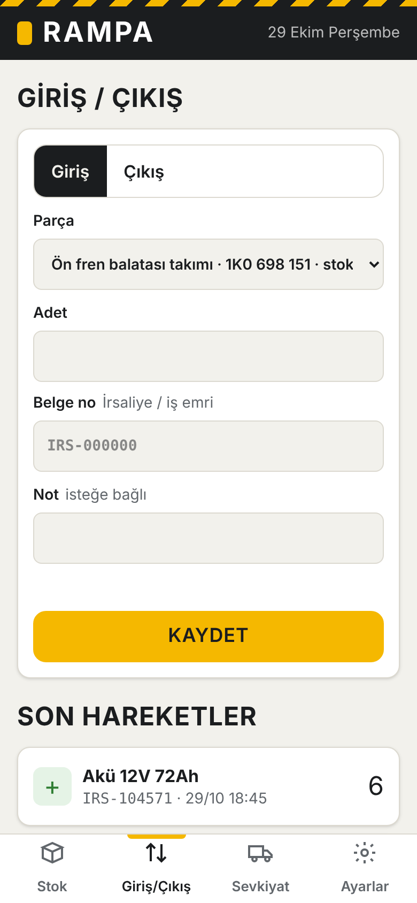
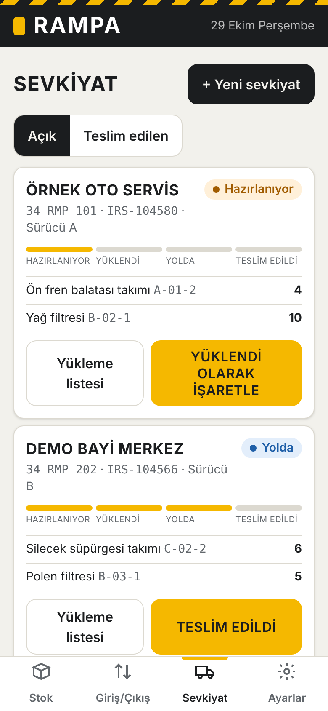

<h1 align="center">🚚 Rampa</h1>

<p align="center">
  <b>Yedek parça depoları için stok, irsaliyeli giriş/çıkış ve sevkiyat takibi.</b><br>
  Kurulum yok, sunucu yok. Tek bir HTML dosyası, tarayıcıda açılır.
</p>

<p align="center">
  <a href="https://github.com/harunnkcnn/rampa/actions/workflows/ci.yml"></a>
  
  
  
  
  
</p>

<p align="center">
  <a href="https://harunnkcnn.github.io/rampa/"><b>▶ Canlı demo</b></a> ·
  <a href="#user-content-kurulum">Kurulum</a> ·
  <a href="#user-content-rampa-pro">Pro sürüm</a> ·
  <a href="#user-content-english">English</a>
</p>

<p align="center">
  
  
  
</p>

---

## Neden?

Bir depoda bir parçanın hikâyesi çoğu zaman üç ayrı yerde yazılır: mal kâğıt irsaliyeyle gelir, stok Excel'de tutulur, sevkiyatın nerede olduğu telefonla sorulur. Her geçişte bilgi ya gecikir ya kaybolur.

Rampa bu üç adımı tek ekranda toplar. Bir sevkiyat görevlisinin rampada gördüklerinden yola çıkarak tasarlandı.

## Özellikler

- **Stok**: Parçayı OEM/parça kodu, ad ve raf adresiyle (`A-03-2` gibi) tutar. Kritik stok kendiliğinden öne çıkar; durum hem renkle hem yazıyla gösterilir (Tükendi, Kritik, Düşük, Yeterli).
- **Giriş / çıkış**: Her hareket bir belge numarasıyla (irsaliye, iş emri) kaydedilir. Stokta olmayan parça çıkarılamaz.
- **Sevkiyat**: Alıcı, plaka, şoför ve kalemlerle sevkiyat oluşturulur. Durum adım adım ilerler: Hazırlanıyor → Yüklendi → Yolda → Teslim edildi. "Yüklendi" adımında stoktan otomatik düşülür.
- **Yükleme listesi**: Tek dokunuşla şoföre gönderilecek listeyi hazırlar; telefonda paylaşım menüsünü açar, bilgisayarda panoya kopyalar.
- **Arama ve filtre**: Kod, ad veya raf adresine göre arama; yalnızca kritik stoku gösterme.
- **Yedek**: Tüm veriyi JSON olarak indirme ve geri yükleme.
- **Sahaya uygun arayüz**: Telefonda tek elle kullanım için büyük butonlar ekranın alt yarısında, parça kodları karışmasın diye sabit genişlikli yazı, açık ve koyu tema.

## Kurulum

Kurulum gerekmez. İki yol var:

1. **Tarayıcıda deneyin:** [canlı demo](https://harunnkcnn.github.io/rampa/)
2. **Kendi bilgisayarınızda kullanın:** [rampa.html dosyasını indirin](https://github.com/harunnkcnn/rampa/raw/gh-pages/index.html) ve çift tıklayıp tarayıcıda açın. İnternet bağlantısı gerekmez.

Bu dosya her güncellemede GitHub Actions tarafından otomatik derlenip `gh-pages` dalına konur.

İlk açılışta örnek verilerle gelir. **Ayarlar → Boş başla** ile kendi verinize geçebilirsiniz.

> **Veriler nerede saklanır?** Yalnızca o cihazdaki tarayıcının yerel depolamasında; hiçbir sunucuya gönderilmez. **Ayarlar → Yedek indir** ile düzenli yedek almanız önerilir. Cihazlar arasında otomatik eşitleme yoktur.

## Geliştirme

Node.js 20+ gerekir.

```bash
npm install
npm run dev        # geliştirme sunucusu
npm test           # domain testleri
npm run typecheck  # TypeScript tip kontrolü
npm run build      # dist/index.html (tek dosya)
```

### Teknoloji

| Katman | Kullanılan |
| --- | --- |
| Arayüz | React 19, TypeScript (strict) |
| Stil | Tailwind CSS 4, açık/koyu tema |
| Derleme | Vite 6, `vite-plugin-singlefile` ile tek HTML çıktısı |
| Test | Node test runner + tsx |
| CI/CD | GitHub Actions: tip kontrolü, test, derleme, GitHub Pages |
| Veri | Tarayıcı `localStorage`, JSON yedek |

### Proje yapısı

```
src/
├── domain/        # İş kuralları: saf fonksiyonlar, arayüzden bağımsız ve test edilir
│   ├── types.ts
│   ├── rampa.ts   # stok seviyesi, hareket, sevkiyat, yükleme listesi
│   └── demo.ts
├── components/    # Stok, Giriş/Çıkış, Sevkiyat, Ayarlar ekranları ve UI parçaları
├── hooks/         # useRampa: veri durumu ve kalıcılık
├── lib/           # depolama ve biçimlendirme yardımcıları
├── App.tsx
└── main.tsx
tests/
└── rampa.test.ts  # stok, hareket ve sevkiyat kuralları
```

Tüm iş kuralları `src/domain` içinde saf fonksiyonlar olarak durur: her işlem yeni veri döndürür ya da açıklayıcı bir hata mesajı verir (`Result<T>`). Örneğin stokta olmayan parça çıkarılamaz, belge numarası olmayan hareket kaydedilmez, sevkiyat "Yüklendi" adımında stoktan bir kez düşülür.

## Yol haritası

- [ ] Barkod / QR ile parça arama
- [ ] Sayım modu (raf raf stok sayımı)
- [ ] Çoklu depo
- [ ] Yapay zekâ ile irsaliye okuma

Öneri ve hata bildirimi için [Issues](https://github.com/harunnkcnn/rampa/issues) bölümünü kullanabilirsiniz. Katkı vermek isterseniz [CONTRIBUTING.md](CONTRIBUTING.md) dosyasına bakın. Sürüm notları [CHANGELOG.md](CHANGELOG.md) içinde.

## Rampa Pro

Bu repo Rampa'nın ücretsiz, açık kaynak sürümüdür. Pro sürümde ek olarak:

- 7 günlük stok ve sevkiyat raporu
- Kritik stok için sipariş önerisi
- Araç doluluk planı

Pro sürüm ticari lisansla sunulur. Bilgi için [LinkedIn](https://www.linkedin.com/in/harun-ka%C3%A7an-58b423335/) üzerinden yazabilirsiniz.

## Lisans

[MIT](LICENSE) © 2026 Harun Kaçan

---

## English

**Rampa** is a single-file stock and shipment tracker for auto parts warehouses: parts with OEM codes and shelf addresses, stock in/out with document numbers (no negative stock), shipments that move through *Preparing → Loaded → On the road → Delivered*, and a one-tap loading list for the driver. Built with React 19, TypeScript (strict), Tailwind CSS 4 and Vite; the build output is a single self-contained `dist/index.html`, so end users need no install or server. Business rules live in `src/domain` as pure, tested functions. Data stays in the browser's local storage; use **Ayarlar → Yedek indir** for backups. UI is in Turkish. MIT licensed.

<p align="center"><sub>Geliştiren: <a href="https://github.com/harunnkcnn">Harun Kaçan</a> · Tasarım ve yazılım işleri için <a href="https://www.behance.net/harunkaan1">Behance</a> · <a href="https://www.linkedin.com/in/harun-ka%C3%A7an-58b423335/">LinkedIn</a></sub></p>
