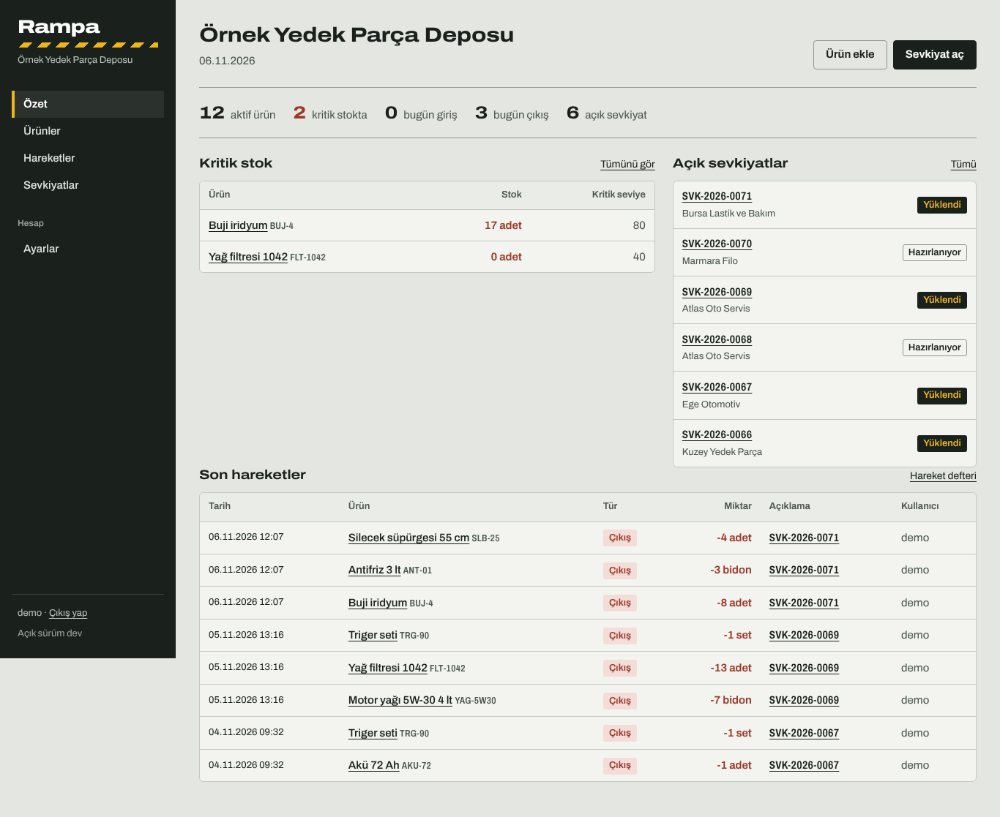
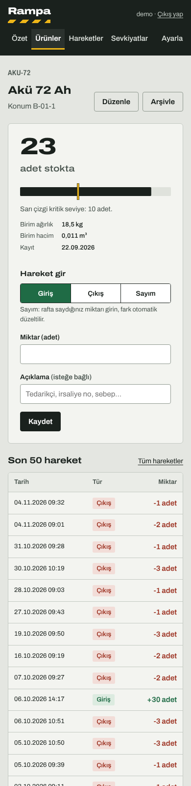
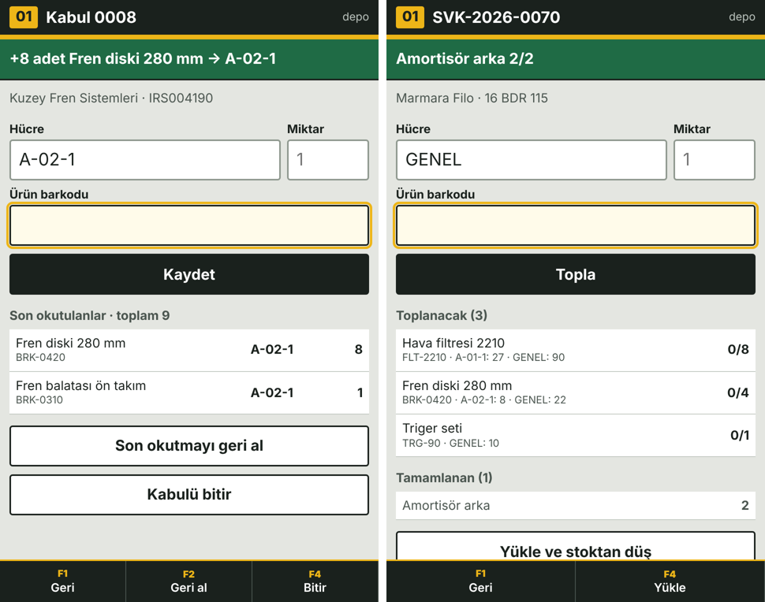

# Rampa

**Tanıtım sayfası:** https://harunnkcnn.github.io/rampa/

Küçük ve orta ölçekli depolar için stok, hücre (raf gözü) takibi, mal kabul, sevkiyat ve el terminali. Tek dosya, kurulum yok: indir, çalıştır, tarayıcıda aç.



Rampa bir depo görevlisinin gününe göre tasarlandı: mal kabul, raf, sevkiyat, araç, teslim. Ürünü bulursunuz, büyük stok rakamını görürsünüz, girişi ya da çıkışı iki dokunuşla kaydedersiniz. Sevkiyatı "Yükle" dediğiniz anda satırlar stoktan düşer; iptal ederseniz stoğa geri döner.

## Özellikler

- **Şube, depo ve hücre:** stok hücre bazında tutulur. Her depoda rafa kaldırılmamış mal için bir GENEL hücresi olur; `A-01-1..6` yazarak toplu hücre açılır, hücre etiketleri Code128 barkodla yazdırılır
- **El terminali (`/t`):** Mal kabul, sevkiyat toplama, kör sayım, hücre sorgu ve transfer, paketleme. Barkod okuyucuyla, dokunmadan kullanılır (ayrıntı aşağıda)
- **Stok kartları:** stok kodu, barkod, raf konumu, birim, kritik seviye, birim ağırlık ve hacim
- **Hareket defteri:** giriş, çıkış, sayım ve transfer; her satırda hücre. Kayıtlar silinmez; düzeltme sayımla yapılır, fark otomatik hesaplanır
- **Mal kabul:** tedarikçi ve irsaliye numarasıyla belge; okutulan her satır anında stoğa girer, son okutma geri alınabilir
- **Sevkiyat:** taslak → yüklendi → teslim edildi. Terminalde okutulan miktarlar okutulduğu hücreden, kalanlar otomatik olarak depodaki hücrelerden düşer. İptalde her birim çıktığı hücreye döner. Yükleme tek işlemde (transaction) yapılır; stok yetmezse hiçbir şey düşülmez
- **Paketleme:** sevkiyat için koli ve palet, 100×60 mm koli etiketi
- **Kritik stok uyarısı** ve günlük özet
- **CSV dışa aktarım:** Türkçe Excel'de doğru açılır (UTF-8 BOM, noktalı virgül), formül enjeksiyonuna karşı korumalı
- **Ondalıklı miktar:** kg, metre, litre gibi birimler için `12,5` ya da `1.250` yazılabilir; miktarlar kayan nokta hatası olmadan binde bir hassasiyetle tutulur
- **Çok kullanıcı:** yönetici ve depo kullanıcısı; kullanıcı bazında depo yetkisi, terminal için PIN
- **Mobil uyumlu:** rampada telefondan kullanılacak şekilde

<p align="center"></p>

## El terminali



Depo personeli `http://SUNUCU:8080/t` adresini terminalin tarayıcısında açar, kullanıcı adı ve PIN'le girer. Ekranlar 480 px dikey ekran ve tuş takımı için çizildi:

- Okuyucu barkodu yazıp Enter'a bastığında imleç bir sonraki kutuya geçer: hücreyi okut → ürünü okut → kaydedildi. Miktar boş bırakılırsa 1 sayılır.
- **F1** geri, **F2–F4** ekranın alt çubuğundaki işlemler; menüde **1–5** tuşları.
- Hata olunca ekran kırmızı olur ve cihaz bip sesi verir (destekleniyorsa titrer).
- Sayım kördür: kayıttaki miktar gösterilmez. Bitirince fark sayım hareketi olarak işlenir; kayıtta olup okutulmayan ürünler o hücrede sıfırlanır.
- PIN ile açılan oturum yalnızca terminal ekranlarını açar; yönetim paneline parola gerekir.
- Sayfalar JavaScript olmadan da çalışan düz formlardır; CSS eski gömülü tarayıcıları da (Windows terminallerdeki IE11 dahil) hedefler.

Kurulum ve okuyucu ayarları için [docs/el-terminali.md](docs/el-terminali.md).

## Hızlı başlangıç

[Releases](https://github.com/harunnkcnn/rampa/releases) sayfasından işletim sisteminize uygun dosyayı indirip çalıştırın:

```bash
./rampa                # http://127.0.0.1:8080
```

İlk açılışta yönetici hesabını oluşturursunuz. Veriler aynı klasördeki `rampa.db` dosyasında durur; yedek almak için bu dosyayı kopyalamanız yeterli.

Örnek veriyle denemek için:

```bash
go run ./cmd/rampa-demo -db demo.db
go run ./cmd/rampa -db demo.db       # panel: demo / demo-parola
                                     # terminal (/t): depo / PIN 1234
```

## Yapılandırma

Her ayar hem bayrak hem ortam değişkeni olarak verilebilir.

| Bayrak | Ortam değişkeni | Varsayılan | Açıklama |
|---|---|---|---|
| `-addr` | `RAMPA_ADDR` | `127.0.0.1:8080` | Dinlenecek adres. Ağdaki diğer cihazlar için `0.0.0.0:8080` |
| `-db` | `RAMPA_DB` | `rampa.db` | SQLite veritabanı dosyası |
| `-secure-cookie` | `RAMPA_SECURE_COOKIE` | `false` | HTTPS arkasında çalışırken açın |

Docker ile:

```bash
docker build -t rampa .
docker run -p 8080:8080 -v rampa-data:/data rampa
```

## Teknik tercihler

| Katman | Seçim | Neden |
|---|---|---|
| Sunucu | Go 1.24, standart `net/http` | Tek, bağımlılıksız çalıştırılabilir dosya; Windows dahil her platforma çapraz derleme |
| Veritabanı | SQLite ([ncruces/go-sqlite3](https://github.com/ncruces/go-sqlite3), CGO'suz) | Sunucu kurulumu yok, tek dosyada yedek, WAL ile eşzamanlı okuma |
| Arayüz | Sunucuda render edilen HTML + [htmx](https://htmx.org) | JavaScript derleme zinciri yok; sayfa JS olmadan da çalışır |
| Tipografi | Archivo (değişken genişlik), dosyaya gömülü | İnternetsiz depoda da aynı görünüm |

Bağımlılık listesi bilerek kısa: SQLite sürücüsü dışında üçüncü parti Go paketi yok.

### Güvenlik

- Parolalar PBKDF2-SHA256, 600.000 tur (OWASP önerisi), sabit zamanlı karşılaştırma
- Oturum belirteci veritabanında yalnızca SHA-256 özeti olarak tutulur; çerez `HttpOnly` ve `SameSite=Lax`
- CSRF: oturuma bağlı belirteç + `Sec-Fetch-Site`/`Origin` kontrolü
- Giriş denemelerinde IP başına ve (terminalde) kullanıcı başına hız sınırı; kullanıcı adı var/yok bilgisi zamanlamadan sızmaz
- Terminal PIN'leri parolalar gibi özetlenir; PIN oturumu yönetim paneline giremez
- Depo yetkisi sunucuda denetlenir: yetkisi olmayan depo kaydı adres yazılarak da açılamaz
- Katı Content-Security-Policy (satır içi script ve stil yok), `X-Frame-Options: DENY`
- Açık yönlendirme (open redirect) koruması, tüm SQL sorguları parametreli

### Proje yapısı

```
cmd/rampa          çalıştırılabilir dosya
cmd/rampa-demo     örnek veri üretici
app/               HTTP, oturum, panel ve terminal ekranları, Code128, eklenti API'si
store/             SQLite katmanı, migration'lar, iş kuralları
web/               gömülü şablonlar (panel ve templates/terminal) ve statik dosyalar
```

`app.Extension` arayüzü üzerinden yeni ekranlar, menü öğeleri ve tablolar eklenebilir. Çekirdek hiçbir eklentiyi import etmez.

## Geliştirme

```bash
go test ./...
go run ./cmd/rampa -db dev.db
```

## Rampa Pro

Raporlar, kritik stok sipariş önerisi ve tır yükleme planı (LDM, palet yerleşimi, boşaltma sırası, ağırlık merkezi) ayrı, ticari lisanslı bir sürümde. Bu depoda Pro kodu yoktur; açık sürüm tek başına eksiksiz çalışır. 14 gün ücretsiz deneme için iletişime geçin.

## Lisans

[MIT](LICENSE). Archivo yazı tipi [SIL Open Font License](web/static/fonts/OFL.txt) ile dağıtılır.

---

**English:** Rampa is a self-hosted stock, goods-in/out and shipment tracker for small warehouses. A single Go binary with an embedded SQLite database and a server-rendered htmx UI. MIT licensed.
